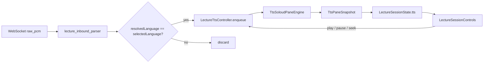

# Lecture Viewer TTS Playback — Design Spec

**Date:** 2026-05-18  
**Project:** `lecture_viewer_v3`  
**Status:** Approved in brainstorming (Approach 1)  
**Amends:** `docs/superpowers/specs/2026-05-18-lecture-session-view-design.md` (TTS row: text-only → selected-language playback)  
**Source:** `docs/1-session_view.md`, `app_2way_v3` TTS/PCM handling, `lecture_common` `TranslationTtsTransport`

## Goal

Add **manual TTS playback** to the in-app lecture meeting view. Controls live in **`LectureSessionControls`**:

- **Collapsed:** play/pause icon always visible in the header row.
- **Expanded:** full shared **`TranslationTtsTransport`** (play/pause, seek slider, buffered duration, pending-download indicator).

Playback is **receive-only** (no mic, no auto-TTS, no uplink). Audio follows the **selected display language** only.

## Decisions (brainstorming)

| Topic | Decision |
|-------|----------|
| Architecture | **Approach 1** — viewer-local `LectureTtsController` + single SoLoud engine (port minimum from `app_2way_v3`) |
| Backlog `raw_pcm` | **Selected language only** — parse/enqueue PCM only when resolved language equals `selectedLanguage`; drop all others during backlog and live |
| Collapsed UI | **Play/pause only** — no slider or duration in collapsed row |
| Expanded UI | Full **`TranslationTtsTransport`** from `lecture_common` |
| Language change | **Switch stream** — pause, clear buffer, reset snapshot; enqueue only for new language; user taps play again |
| Shortening change | **No TTS reset** — TTS is per language (`tts:*` in `computedSenders`), not per `mt:` / `postproduction:*` transcript route |
| Start playback | **Manual start** — audio does not begin until the user taps Play |
| Continuous play | **After Play, run until Pause** — once the user starts playback, the engine keeps playing through the buffer and **automatically continues** as new `raw_pcm` chunks arrive; only a user tap on Pause/Stop ends playback |
| Shared package | **UI only** in `lecture_common`; playback engine stays in viewer for this phase |

---

## Amends prior spec

`2026-05-18-lecture-session-view-design.md` stated:

- TTS: ignore all `raw_pcm`
- Viewer: no `TranslationTtsTransport` on meeting screen

This spec **replaces** those outcomes for the lecture meeting screen. Transcript routing and `lecture_common` transcript widgets are unchanged.

---

## Architecture



### New / changed pieces (`lecture_viewer_v3`)

| Path | Role |
|------|------|
| `lib/features/lecture_session/data/inbound/lecture_tts_pcm_event.dart` | Immutable PCM event (`url`, `rawSender`, `languageFromPayload`, optional `index`) |
| `lib/features/lecture_session/data/inbound/lecture_inbound_parser.dart` | Add `raw_pcm` branch → `LectureInboundTtsPcm` (mirror 2-way `_parseRawPcm`: `tts:` prefix, URL required) |
| `lib/features/lecture_session/data/inbound/lecture_inbound_message.dart` | Sealed variant `LectureInboundTtsPcm` |
| `lib/features/lecture_session/domain/tts/lecture_tts_language.dart` | `resolveLectureTtsLanguage(event, computedSenders)` |
| `lib/features/lecture_session/domain/tts/lecture_tts_controller.dart` | Single-pane orchestration: enqueue, play/pause, seek, `reset()`, dispose |
| `lib/features/lecture_session/domain/tts/tts_soloud_pane_engine.dart` | Port from `app_2way_v3` (or copy + trim to viewer needs) |
| `lib/features/lecture_session/domain/tts/tts_pcm_http_fetch.dart` | Port PCM HTTP download helper from 2-way |
| `lib/features/lecture_session/presentation/lecture_session_state.dart` | Add `tts: TtsPaneSnapshot` (default empty) |
| `lib/features/lecture_session/presentation/providers/lecture_session_notifier.dart` | Wire PCM, language reset, `ttsPlayPause` / `ttsSeekEnd`, dispose controller |
| `lib/features/lecture_session/presentation/lecture_session_controls.dart` | Collapsed play button + expanded `TranslationTtsTransport` |
| `lib/core/bootstrap/soloud_engine.dart` | Init/deinit SoLoud (mirror 2-way) |
| `lib/app/soloud_lifecycle_binding.dart` | App lifecycle dispose (mirror 2-way) |
| `lib/main.dart` | Call `initializeSoloudEngine()` before `runApp` |
| `pubspec.yaml` | Add `flutter_soloud` (same major as `app_2way_v3`) |

### Unchanged

| Piece | Notes |
|-------|-------|
| `lecture_common` | Use existing `TtsPaneSnapshot`, `TranslationTtsTransport` — no playback logic in package |
| `app_2way_v3` | No changes in this phase |
| Transcript reducer / router | `tts` remains unsupported as a **text** module type |

---

## Inbound & language routing

### Parse `raw_pcm`

Same rules as `app_2way_v3` `translation_inbound_parser._parseRawPcm`:

- `objectType == 'raw_pcm'`
- `data.url` non-empty string
- `data.rawSender` starts with `tts:`
- Language hint from `senderDetail.language` or `data.language`

### Resolve display language

`resolveLectureTtsLanguage(event, computedSenders)`:

1. `event.languageFromPayload` if non-empty  
2. Else `computedSenders[event.rawSender]?.language` if present  

If resolution fails → treat message as ignored (no enqueue).

### Gate before enqueue

Enqueue only when:

```text
resolvedLanguage == state.selectedLanguage
```

No separate backlog phase flag: the gate applies to every message (backlog flood and live). Non-selected languages are never downloaded.

### Language change (`setLanguage`)

When `selectedLanguage` changes:

1. Pause playback if active  
2. `LectureTtsController.reset()` — clear PCM buffer, reset `TtsPaneSnapshot` to defaults  
3. Update state; subsequent PCM for the new language enqueues normally  

`setModule` (shortening) does **not** call reset.

---

## Playback behavior

Matches `app_2way_v3` `TtsSoloudPaneEngine` manual-play semantics (port unchanged):

1. **Before first Play:** PCM may download and buffer (`bufferedDurationSec` grows) but **no audio output**.
2. **User taps Play:** Set `_userWantsPlayback = true`, start at resolved playhead (tail-join rules via `resolveTtsPlayStart`).
3. **While `_userWantsPlayback`:**  
   - Play through already-buffered audio.  
   - When new chunks finish downloading, `_resumePlaybackIfNeededAfterAppend` unpauses or restarts the voice so playback **does not stop** at chunk boundaries.  
   - If the playhead reaches the buffer tail, wait for more PCM and resume when it arrives (no second Play tap required).
4. **User taps Pause:** Set `_userWantsPlayback = false`, stop audio output, **keep** buffer and playhead (same chunk can resume on next Play).

This is **not** session auto-TTS (no mic/VAD); it is **continuous output after an explicit Play** until an explicit Pause.

---

## `LectureTtsController`

Viewer-local, single engine. Responsibilities:

| Method | Behavior |
|--------|----------|
| `enqueue(String url)` | Forward to `TtsSoloudPaneEngine`; if user already pressed Play, engine auto-continues when chunk is appended |
| `playPauseFromUser()` | Toggle play/pause (`playFromUserTap` / `pauseFromUserTap` — pause does **not** clear buffer) |
| `seekEnd(double normalized)` | Seek within buffered range |
| `reset()` | Stop, clear buffer, clear `_userWantsPlayback`, emit empty snapshot |
| `dispose()` | Release engine |

`onSnapshot(TtsPaneSnapshot)` callback updates `LectureSessionState.tts` via notifier.

**Explicitly out of scope for this controller:**

- `LiveTtsController` auto-TTS / VAD  
- Mic ducking / `TranslationSessionCoordinator`  
- Partner vs You dual panes  

---

## UI: `LectureSessionControls`

### Collapsed header row (left → right)

1. **Play/pause** `IconButton` — `onPressed` null when `bufferedDurationSec == 0`  
2. **Summary** — existing `language · module` text  
3. **WS phase** label  
4. **Expand** chevron  

Icon: `Icons.play_arrow` / `Icons.pause` from `tts.isPlaying`.

### Expanded section

Below language / shortening dropdowns and font row:

```dart
TranslationTtsTransport(
  snapshot: tts,
  onPlayPause: notifier.ttsPlayPause,
  onSeekEnd: notifier.ttsSeekEnd,
)
```

Reuse `ref.watch` with `.select((s) => s.tts)` to limit rebuilds.

---

## Dependencies & lifecycle

- Add `flutter_soloud: ^3.5.4` (align with `app_2way_v3`)  
- `main.dart`: `WidgetsFlutterBinding.ensureInitialized()` → `await initializeSoloudEngine()` → `runApp`  
- Wrap app with `SoloudLifecycleBinding` (deinit on detach)  
- `LectureSessionNotifier`: create controller in `build` or on first PCM; `ref.onDispose` → `controller.dispose()`  

---

## Testing

| Area | Tests |
|------|-------|
| Parser | `raw_pcm` valid → `LectureInboundTtsPcm`; missing URL / non-`tts:` → ignored |
| Language resolve | payload language; fallback via `computedSenders` |
| Gate | PCM for other language not enqueued (mock controller) |
| Language switch | `setLanguage` calls `reset` and clears snapshot |
| Widget (optional) | Collapsed play disabled with empty buffer; enabled with `bufferedDurationSec > 0` |

### Manual test plan

1. Join session with multiple languages; confirm only selected language buffers (play enabled after backlog for that language).  
2. Tap Play once → audio plays through buffered content **and keeps playing** as live `raw_pcm` arrives; tap Pause to stop.  
3. Play → pause → Play again resumes from playhead without re-buffering.  
4. Seek in expanded controls while paused or playing.  
5. Collapsed play/pause works without expanding.  
6. Change language → playback stops, buffer clears, play disabled until new language buffers; tap Play again for continuous play on new language.  
7. Change shortening only → TTS buffer unchanged.  
8. Leave session → no SoLoud leak / crash on re-enter.

---

## Out of scope

- Moving playback engine into `lecture_common` (future optional refactor)  
- Session auto-TTS (mic/VAD-driven start), mic interaction, dual-pane partner/you  
- TTS per shortening level (no `tts:postproduction:*` streams in current protocol)  
- Buffering multiple languages while switching (user chose single active stream)  
- History / offline lecture TTS replay  

---

## Implementation note

Port files from `app_2way_v3` with package/import renames; keep behavior identical for engine + HTTP fetch. Reference implementations:

- `translation_inbound_parser._parseRawPcm`  
- `tts_soloud_pane_engine.dart`  
- `tts_pcm_http_fetch.dart`  
- `translation_tts_language_resolution.dart` (adapt to `computedSenders` instead of `Language` list)
