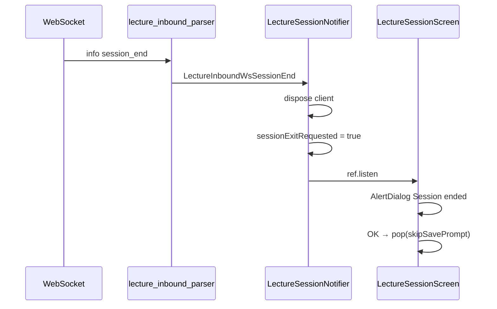

# Handle WebSocket `session_end` — Design Spec

**Date:** 2026-05-19  
**Project:** `lecture_viewer_v3`  
**Status:** Approved in brainstorming  
**Source:** `docs/3-handle-meeting-already-end.md`

## Goal

When the lecture-session WebSocket returns an `info` message with `data.status == "session_end"` (any `reason`, e.g. `session_already_over`), show a dialog explaining the session is unavailable, then return the user to the home screen on OK. Do not clear saved lectures, local snapshots, or in-session transcript history.

## Decisions (brainstorming)

| Topic | Decision |
|-------|----------|
| Trigger | Any `data.status == "session_end"` on `objectType: "info"` |
| Exit UX | Non-dismissible dialog → single **OK** → pop session route to home |
| Save prompt | **Skip** — no "Save lecture?" on this exit path |
| History / persistence | **Do not delete or clear** snapshots, saved lectures, or transcript state |
| Live `data.status == "END"` | **Out of scope** — keep current behavior (parse + debug log only) |
| Dialog copy | Title: **"Session ended"**; body: **"This session is no longer available."** (generic; no per-`reason` copy in v1) |
| Architecture | **Approach A:** parser → notifier state flag → `ref.listen` on session screen |

## Problem today

Sample payload (also in `README.md`):

```json
{
  "message": "connected",
  "status": 200,
  "data": {
    "status": "session_end",
    "reason": "session_already_over"
  },
  "objectType": "info"
}
```

The parser only recognizes `data.status == "END"` as session end. The `session_end` shape falls through to empty `LectureInboundInfo`, which the notifier ignores (no language metadata). The user stays on **"Loading session…"** indefinitely.

---

## Parsing

**File:** `lib/features/lecture_session/data/inbound/lecture_inbound_parser.dart`

In `_parseInfo`, before the `END` branch and before language-metadata parsing:

```dart
if (data['status'] == 'session_end') {
  return LectureInboundWsSessionEnd(
    reason: data['reason']?.toString(),
  );
}
```

Keep the existing `END` branch unchanged:

```dart
if (data['status'] == 'END') {
  return LectureInboundSessionEnd(audioUrl: data['audioUrl']?.toString());
}
```

**File:** `lib/features/lecture_session/data/inbound/lecture_inbound_message.dart`

Add a sealed subtype distinct from live end:

```dart
/// WebSocket closed the session before or without live content (`session_end`).
final class LectureInboundWsSessionEnd extends LectureInboundMessage {
  const LectureInboundWsSessionEnd({this.reason});
  final String? reason;
}
```

`LectureInboundSessionEnd` remains for `data.status == 'END'` only.

**Tests:** `test/features/lecture_session/lecture_inbound_parser_test.dart` — assert README sample parses to `LectureInboundWsSessionEnd` with `reason == 'session_already_over'`.

---

## Notifier

**File:** `lib/features/lecture_session/presentation/providers/lecture_session_notifier.dart`

**State:** add `sessionExitRequested` (bool, default `false`) to `LectureSessionState`.

On `LectureInboundWsSessionEnd`:

1. `await _disposeClient()` — stop WebSocket and reconnect loop.
2. `state = state.copyWith(sessionExitRequested: true)` — idempotent if already true.
3. Do **not** call `deleteLectureSnapshotForLinkRecord`, do **not** clear `transcript` / `computedSenders`, do **not** modify `savedLectures`.

On `LectureInboundSessionEnd` (`END`): unchanged (debug log only).

---

## UI

**File:** `lib/features/lecture_session/presentation/lecture_session_screen.dart`

Use `ConsumerStatefulWidget` (or a small child widget) with `ref.listen`:

- When `sessionExitRequested` transitions to `true`, show `AlertDialog` with `barrierDismissible: false`.
- Single **OK** action: pop to home **without** save prompt.

**Skip save prompt on programmatic exit**

`PopScope` currently always runs `handleLectureSessionExit` on back. For OK after `session_end`:

- Add `skipSavePrompt` parameter to `handleLectureSessionExit` in `save_lecture_on_exit.dart` (returns `true` immediately when set), **or**
- Set a local `_skipSavePrompt` flag on the screen before `Navigator.pop()`.

Recommended: `skipSavePrompt` on `handleLectureSessionExit` for clarity and testability.

**Duplicate messages:** guard dialog with a local `_dialogShown` flag or only listen on `false → true` transition.

**System back while dialog open:** dialog is modal; user must tap OK.

---

## Data flow



---

## Edge cases

| Case | Behavior |
|------|----------|
| `session_end` before any language info | Dialog shows; fixes infinite loading spinner |
| Multiple `session_end` messages | Dialog shown once |
| User had saved this lecture already | Still skip save prompt; pop home |
| Join flow snapshot delete | Unchanged — only runs when user confirms Join on home/QR, not on `session_end` exit |

---

## Out of scope

- UI or navigation for live `data.status == "END"`
- Per-`reason` dialog strings
- Auto-save transcript on session end
- Changes to `app_2way_v3` or backend

---

## Files to touch (implementation)

| File | Change |
|------|--------|
| `lecture_inbound_message.dart` | Add `LectureInboundWsSessionEnd` |
| `lecture_inbound_parser.dart` | Parse `session_end` |
| `lecture_inbound_parser_test.dart` | New test |
| `lecture_session_state.dart` | `sessionExitRequested` |
| `lecture_session_notifier.dart` | Handle new message type |
| `lecture_session_screen.dart` | `ref.listen` + dialog |
| `save_lecture_on_exit.dart` | `skipSavePrompt` (if used from PopScope path) |
