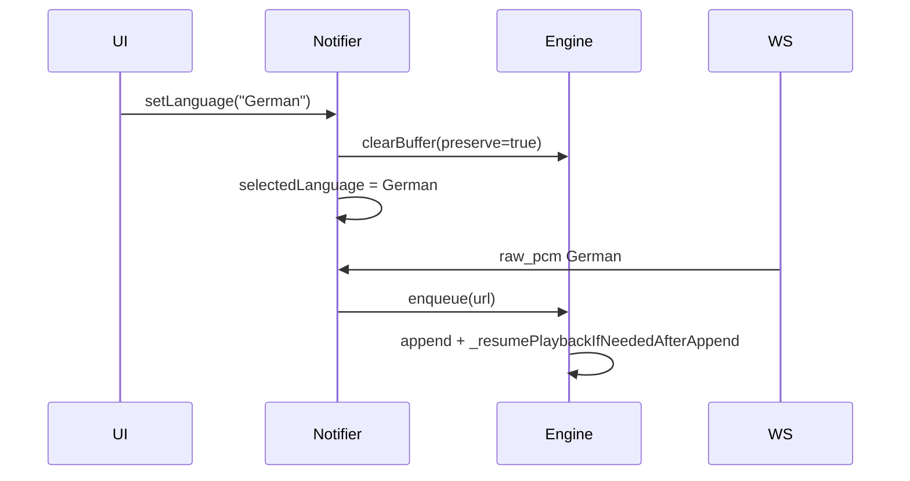

# Share UI simplification + TTS on language change — Design Spec

**Date:** 2026-05-19  
**Project:** `lecture_viewer_v3`  
**Status:** Approved in brainstorming  
**Source note:** `README.md` (viewer backlog bullets)

## Goal

1. **Share sheet:** Remove the “Include transcript” toggle; sharing always exports transcript `.txt` files (the only v1 export type).
2. **Live TTS:** When the user changes the selected language, do **not** turn off TTS playback intent. If TTS was **playing**, clear the old-language buffer and **auto-play** PCM for the new language as chunks arrive. If TTS was **paused** (or never started), stay paused.

## References

- **Share sheet:** `lib/features/lecture_session/presentation/lecture_share_sheet.dart`
- **Share design (v1):** `docs/superpowers/specs/2026-05-19-lecture-viewer-share-design.md`
- **Language change:** `lib/features/lecture_session/presentation/providers/lecture_session_notifier.dart` (`setLanguage`, `_resetTtsForLanguageChange`)
- **TTS engine:** `lib/features/lecture_session/domain/tts/tts_soloud_pane_engine.dart` (`clear`, `_userWantsPlayback`, `_resumePlaybackIfNeededAfterAppend`)
- **TTS gate:** `lib/features/lecture_session/domain/tts/lecture_tts_gate.dart`
- **TTS language support:** `lib/features/lecture_session/domain/tts/lecture_tts_language.dart` (`isTtsSupportedForLanguage`)

## Brainstorming decisions

| Topic | Decision |
|-------|----------|
| Include transcript toggle | **Remove** from UI and state; export is always transcript |
| TTS while **playing** + language change | Clear old buffer; **preserve** `_userWantsPlayback`; auto-play new-language PCM when appended (**A**) |
| TTS while **paused** + language change | Clear buffer; **do not** preserve playback intent; no auto-play (**A**) |
| `setModule` (same language) | **No** TTS buffer clear |
| Scope | Live `LectureSessionScreen` only for TTS; share sheet on live + `LectureSnapshotScreen` |
| Snapshot screen TTS | **Out of scope** (snapshot is read-only, no TTS per share spec) |

### Approaches considered

**Share**

| Approach | Verdict |
|----------|---------|
| **A. Remove toggle and `_includeTranscript` state** | **Chosen** |
| B. Disabled toggle, always on | Rejected — confusing dead control |
| C. Hide toggle, keep internal flag | Rejected — unnecessary code |

**TTS on language change**

| Approach | Verdict |
|----------|---------|
| **A. `clearBuffer(preserveUserPlaybackIntent: …)` on engine** | **Chosen** |
| B. Full `clear()` then call `playFromUserTap()` | Rejected — empty buffer / race |
| C. No reset; only filter enqueue by language | Rejected — old-language audio remains in buffer |

## Goals and non-goals

**Goals**

- Share bottom sheet shows only language selection, per-language module dropdown, and Share action.
- Live session: changing language while TTS is playing does not stop the user’s “want to hear TTS” intent.
- Live session: changing language while TTS is paused does not start playback.
- Unit test coverage for buffer clear with preserved vs cleared playback intent.

**Non-goals**

- New export types (audio, summary).
- TTS on offline snapshot screen.
- Changing 2way (`app_2way_v3`) behavior.
- Persisting TTS position across languages (always reset playhead to 0 for new language buffer).

## 1. Share sheet

### Current behavior

- `SwitchListTile` “Include transcript” (default `true`).
- If `_includeTranscript == false`, Share shows snackbar *“Choose transcript to share”* and does not export.
- v1 only supports transcript export; there is no alternate export when the toggle is off.

### New behavior

- Remove `SwitchListTile`, `_includeTranscript`, and the `if (!_includeTranscript)` guard in `_shareSelected`.
- User flow: open sheet → select language(s) → optional module per row → Share → `.txt` files via `share_plus`.
- Validation unchanged: at least one selected language with shareable content; snackbars for empty export unchanged.

### Files

| File | Change |
|------|--------|
| `lecture_share_sheet.dart` | Remove toggle UI and state |
| `lecture_session_share_button_test.dart` (or related) | Update/remove assertions on “Include transcript” if present |

### Acceptance

- Share sheet never shows “Include transcript”.
- Successful share still produces one `.txt` per selected language with content.
- Offline snapshot share uses the same sheet (no TTS controls there).

## 2. TTS on language change (live session)

### Current behavior

```text
setLanguage → _resetTtsForLanguageChange()
  → LectureTtsController.reset() → TtsSoloudPaneEngine.clear()
  → _userWantsPlayback = false, buffer/queue cleared, media session cleared
```

Playback intent is lost even when the user was actively listening.

### New behavior

```text
setLanguage
  → read preserveIntent from engine._userWantsPlayback (before clear)
  → clearBuffer(preserveUserPlaybackIntent: userWantsPlayback)
  → update selectedLanguage / selectedRawSender
  → sync media metadata for new language
```

| Prior state | `preserveUserPlaybackIntent` | After language change |
|-------------|------------------------------|------------------------|
| Playing (`_userWantsPlayback == true`) | `true` | Buffer empty; first new-language PCM append triggers `_resumePlaybackIfNeededAfterAppend` → playback starts |
| Paused / never played (`_userWantsPlayback == false`) | `false` | Buffer empty; PCM may enqueue but engine does not auto-start |
| New language **without** `tts:*` sender | `true` if user was playing | Buffer clears; intent kept so returning to a TTS language auto-resumes; UI shows unavailable (existing UX) |

**`setModule`:** Does not call TTS clear (unchanged).

### Engine API

Add to `TtsSoloudPaneEngine`:

```dart
Future<void> clearBuffer({bool preserveUserPlaybackIntent = false});
```

Implementation: same as existing `clear()` (increment `_clearEpoch`, drain/cancel queue, stop voice/source, reset durations and generation) **except** set `_userWantsPlayback = false` only when `preserveUserPlaybackIntent` is `false`.

- `clear()` (used on dispose / hard stop) continues to call `clearBuffer(preserveUserPlaybackIntent: false)` or remains alias for full reset.
- `LectureTtsController.reset()` remains full reset for dispose paths.
- New method e.g. `clearBufferForLanguageChange({required bool preserveUserPlaybackIntent})` for notifier use.

### Notifier

- Rename `_resetTtsForLanguageChange` → `_clearTtsForLanguageChange` (or keep name with updated semantics).
- Before clear: `preserve = _tts != null &&` engine reports user wants playback (expose getter on controller if needed).
- If `!isTtsSupportedForLanguage(newLanguage, state.computedSenders)`: `preserve = false`.
- After state update: `lectureTtsAudioHandler?.syncFromSnapshot` with new `selectedLanguage` (existing path).

### Sequence (playing → new language)



### Files

| File | Change |
|------|--------|
| `tts_soloud_pane_engine.dart` | `clearBuffer({preserveUserPlaybackIntent})` |
| `lecture_tts_controller.dart` | Delegate language-change clear |
| `lecture_session_notifier.dart` | Preserve intent on `setLanguage` only |
| `test/features/lecture_session/` | Unit test(s) for preserve vs full clear |

### Acceptance

- Start TTS on English, switch to German (both support TTS): transport stays in “playing” mode; audio resumes when German PCM arrives (may be brief silence).
- Pause TTS, switch language: remains paused; no auto-play on first chunk.
- Switch to language without TTS while playing: playback stops; unavailable hint shown.
- Switch module only: TTS buffer and play state unchanged.

## Testing

| Area | Test |
|------|------|
| Share | Widget test: no “Include transcript” finder; share flow still enabled with selections |
| TTS engine | After `clearBuffer(preserve: true)`, internal intent remains true; after `preserve: false`, false |
| Notifier | Optional: language change while “wants playback” does not call full `reset()` semantics (if test harness exists) |

Manual (live session):

1. Play TTS → change language → confirm playback resumes for new language.
2. Pause TTS → change language → confirm still paused.
3. Open share (live and snapshot) → confirm no include-transcript toggle → export works.

## Risks and mitigations

| Risk | Mitigation |
|------|------------|
| Brief silence after language switch while buffering | Expected; existing “Buffering audio” hints in controls |
| In-flight downloads for old language | `_clearEpoch` already cancels stale fetches |
| `isPlaying` snapshot false while `_userWantsPlayback` true during underrun | Use `_userWantsPlayback` for preserve decision, not `TtsPaneSnapshot.isPlaying` alone |
