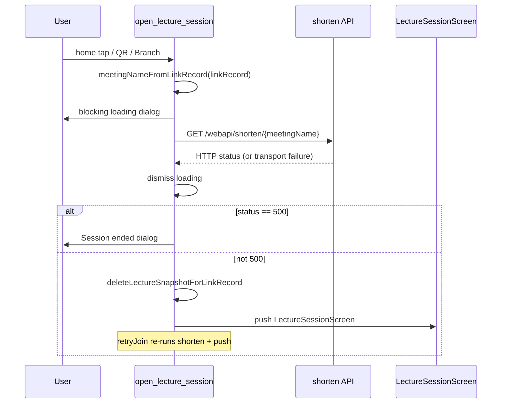

# Pre-join Shorten Session Check — Design Spec

**Date:** 2026-05-20  
**Project:** `lecture_viewer_v3`  
**Status:** Approved in brainstorming  

## Goal

Before opening the in-app meeting view (`LectureSessionScreen`), call the shorten API to detect ended sessions. On HTTP **500**, show a session-unavailable dialog and stay on the current screen. On any other outcome, open the meeting detail immediately with **no** join confirmation dialog.

Applies to **all** entry paths that use `openLectureSessionFromLinkRecord` (home saved-lectures list, QR scan, Branch deep link).

## Decisions (brainstorming)

| Topic | Decision |
|-------|----------|
| API | `GET https://lecture-translator.kit.edu/webapi/shorten/{meetingName}` |
| `{meetingName}` | Last path segment of `link_record` (`meetingNameFromLinkRecord`) — same value as WebSocket `sessionID` today |
| HTTP **500** | Show dialog: title **"Session ended"**, body **"This session is no longer available."** — remain on current screen |
| Non-500 responses | Proceed to meeting detail (includes 2xx, 4xx, other 5xx, network/timeout failures) |
| Join dialog | **Removed** on all entry paths once the shorten check allows join |
| Loading | Blocking overlay/dialog on every entry path until the HTTP call completes |
| Shorten host | Fixed `lecture-translator.kit.edu` (not tied to `ApiEnvironment` production/testing WS hosts) |
| Architecture | **Approach A:** centralize in `open_lecture_session.dart` + small HTTP client in `lib/core/api/` |

## Problem today

`openLectureSessionFromLinkRecord` always shows a **Join event** confirmation dialog, then navigates to `LectureSessionScreen`. Users can confirm join for sessions that are already over; the app only learns via WebSocket `session_end` after connecting.

## Target flow



---

## HTTP client

**New file:** `lib/core/api/lecture_shorten_client.dart`

```dart
/// Returns HTTP status code, or null when no response (timeout, DNS, etc.).
Future<int?> checkShorten(String meetingName);
```

- Build URL: `https://lecture-translator.kit.edu/webapi/shorten/$meetingName` (encode path segment if needed).
- Use `package:http` (already a project dependency).
- Reasonable timeout (e.g. 15–30s).
- **Do not** parse response body; status code only.

**Semantics for callers:**

| Result | Action |
|--------|--------|
| `500` | Session unavailable — show dialog, do not navigate |
| Any other `int?` (including `null`) | Proceed to `LectureSessionScreen` |

---

## Orchestration

**Modify:** `lib/core/util/open_lecture_session.dart`

Replace `showJoinSessionDialog` usage with:

1. Validate `meetingNameFromLinkRecord(linkRecord)` — if null/empty, return `false` (unchanged).
2. Show **blocking** loading dialog (`barrierDismissible: false`).
3. `await lectureShortenClient.checkShorten(meetingName)`.
4. Dismiss loading (guard `context.mounted`).
5. If status == `500`: `showSessionUnavailableDialog` → return `false`.
6. Else: enter session navigation loop (below) — return `true` when user leaves session screen normally.

**Session navigation loop** (logic moved from `join_session_dialog.dart`):

```dart
while (context.mounted) {
  await deleteLectureSnapshotForLinkRecord(linkRecord);
  if (!context.mounted) return false;
  final popResult = await Navigator.push(LectureSessionScreen(...));
  if (popResult == LectureSessionPopResult.retryJoin) {
    // Re-run shorten check from step 2 before pushing again
    continue;
  }
  return true;
}
```

On `retryJoin`, repeat loading + shorten check + push (do not skip availability check).

`openLectureSessionFromAppLink` unchanged in signature; still delegates to `openLectureSessionFromLinkRecord`.

---

## Shared session-unavailable dialog

**New file:** `lib/features/lecture_session/presentation/session_unavailable_dialog.dart`

```dart
Future<void> showSessionUnavailableDialog(BuildContext context);
```

Copy (same as WebSocket `session_end` on `LectureSessionScreen`):

- Title: **Session ended**
- Body: **This session is no longer available.**
- Single **OK** button, `barrierDismissible: false`

**Optional (same PR):** Refactor `lecture_session_screen.dart` `_showSessionEndedDialog` to call this helper for one source of truth.

Pre-join path: dialog dismisses → user stays on home/QR screen (no route pop).

---

## Join dialog

**Modify / slim:** `lib/features/lecture_session/presentation/join_session_dialog.dart`

- Remove join confirmation UI and loop from the public entry path.
- Either delete unused `showJoinSessionDialog` or keep file only if it exports a private helper used by `open_lecture_session` (prefer moving push loop entirely into `open_lecture_session.dart` and deleting join dialog if nothing else imports it).

---

## Call sites (unchanged signatures)

| Caller | File |
|--------|------|
| Home list row tap | `saved_lectures_list.dart` → `openLectureSessionFromLinkRecord` |
| QR scan success | `qr_scan_screen.dart` |
| Branch deep link | `branch_session_listener.dart` |

Home list: still `recordLastJoin` when `openLectureSessionFromLinkRecord` returns `true`. Invalid link snackbar unchanged.

---

## Edge cases

| Case | Behavior |
|------|----------|
| Invalid / empty `link_record` | No API call; return `false` |
| Network error / timeout | Not 500 → open meeting detail |
| Double tap while loading | Loading dialog blocks duplicate navigation |
| Shorten returns 500 on retry | Show dialog again; do not push session |
| User backs out of session normally | Return `true`; home updates `lastJoinedAt` |
| WebSocket `session_end` after join | Existing in-session dialog + pop home (unchanged) |

---

## Testing

| Test | File |
|------|------|
| Client: 500 vs 200 vs thrown exception → status / null | `test/core/api/lecture_shorten_client_test.dart` |
| Open flow: mock client 500 → dialog, no push | `test/core/util/open_lecture_session_test.dart` |
| Open flow: mock client 200 → pushes session route | same |

Use injectable client or top-level override for tests.

---

## Out of scope

- Parsing shorten response JSON
- Mapping shorten API to `ApiEnvironment` testing host
- Changing WebSocket session-end handling
- `app_2way_v3`
- Removing saved lectures when shorten returns 500

---

## Files to touch (implementation)

| File | Change |
|------|--------|
| `lib/core/api/lecture_shorten_client.dart` | New HTTP client |
| `lib/core/util/open_lecture_session.dart` | Loading, shorten check, direct navigation |
| `lib/features/lecture_session/presentation/session_unavailable_dialog.dart` | Shared dialog |
| `lib/features/lecture_session/presentation/join_session_dialog.dart` | Remove or gut join UI |
| `lib/features/lecture_session/presentation/lecture_session_screen.dart` | Optional: use shared dialog |
| `test/core/api/lecture_shorten_client_test.dart` | New |
| `test/core/util/open_lecture_session_test.dart` | New |

---

## Manual verification

- [ ] Home: live session → loading → meeting view (no join dialog)
- [ ] Home: ended session (API 500) → loading → Session ended dialog → stay on home
- [ ] QR / Branch: same as home for live vs ended
- [ ] Airplane mode during check → still opens meeting view (non-500 rule)
- [ ] Server error Retry on session screen → re-runs shorten check
