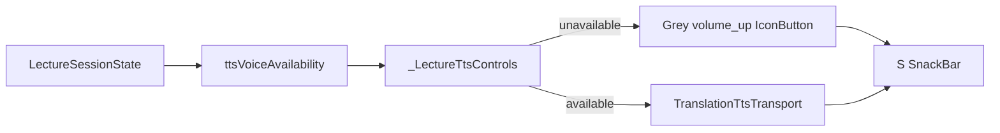

# Lecture Viewer TTS Unavailable UI — Design Spec

**Date:** 2026-05-30  
**Project:** `lecture_viewer_v3`  
**Status:** Approved in brainstorming  
**Amends:** `docs/superpowers/specs/2026-05-18-lecture-viewer-tts-design.md` (controls UX when voice is unavailable)

## Goal

When TTS voice output is not available (Transcript language or language without `tts:*` route), replace the play/slider transport with a **greyed speaker icon** and no seek slider. Tapping the icon shows a **SnackBar** with a context-specific message. When TTS is supported, keep existing play + slider behavior including buffer-wait SnackBars.

## Decisions (brainstorming)

| Topic | Decision |
|-------|----------|
| Feedback on tap | **SnackBar** at bottom (same as current blocked-play pattern) |
| Transcript mode detection | `selectedLanguage == "Transcript"` |
| TTS supported, no buffer yet | **Keep** play + slider; SnackBar for waiting/downloading (unchanged) |
| Static hint text in expanded Controls | **Remove all** — icon + SnackBar only |
| Architecture | **Approach C** — domain helper + viewer UI wrapper; no `lecture_common` changes |
| Collapsed + expanded | Same `_LectureTtsControls` widget in both places |

### Approaches considered

| Approach | Verdict |
|----------|---------|
| **C. Domain helper + viewer UI wrapper** | **Chosen** — testable messages; no shared-package API change |
| A. Viewer-only if/else without helper | Rejected — message logic harder to test |
| B. Extend `TranslationTtsTransport` in `lecture_common` | Rejected — viewer-only UX; YAGNI for 2way |

## Voice availability states

```dart
enum TtsVoiceAvailability {
  available,
  transcriptMode,
  languageUnsupported,
}
```

| State | Condition |
|-------|-----------|
| `transcriptMode` | `selectedLanguage == "Transcript"` |
| `languageUnsupported` | Not Transcript and `!isTtsSupportedForLanguage(...)` |
| `available` | Not Transcript and `isTtsSupportedForLanguage(...)` |

Priority: check `transcriptMode` first (Transcript always maps to transcript message even if no `tts:*` exists).

### User-visible messages (SnackBar)

| State | Message |
|-------|---------|
| `transcriptMode` | `For Voice output, please select a language` |
| `languageUnsupported` | `Voice output not available for this language` |

When `available` but `bufferedDurationSec == 0`, keep existing messages:

- `Waiting for audio. Play will be available once translation audio is buffered.`
- `Downloading translation audio. Play will be available shortly.` (when `pendingDownloadCount > 0`)

## UI behavior

### Unavailable (`transcriptMode` or `languageUnsupported`)

| Element | Behavior |
|---------|----------|
| Icon | `Icons.volume_up`, greyed (`onSurface` at ~38% opacity) |
| Slider | Hidden |
| Duration label | Hidden |
| Tap | SnackBar with message for state |

Icon remains **tappable** (visual disabled style, `onPressed` shows SnackBar).

### Available (`available`)

Use existing **`TranslationTtsTransport`** unchanged:

- Play/pause icon when buffer > 0; play tappable with wait/download SnackBar when buffer == 0
- Slider + duration per existing width breakpoints (96px / 152px)

### Expanded Controls cleanup

Remove from `lecture_session_controls.dart`:

- `_ttsUnavailableMessage` static hint block (`if (!ttsSupported) Padding(...)`)
- `_ttsPlayHint` static hint block (`if (ttsPlayHint != null) Padding(...)`)
- Associated helpers only if fully replaced by domain helper

## Architecture



### Domain (`lecture_tts_language.dart`)

Add:

- `enum TtsVoiceAvailability { available, transcriptMode, languageUnsupported }`
- `TtsVoiceAvailability ttsVoiceAvailability({ required String selectedLanguage, required Map<String, ComputedSenderInfo> computedSenders })`
- `String ttsVoiceUnavailableMessage(TtsVoiceAvailability availability)` — transcript vs unsupported only

Existing `isTtsSupportedForLanguage` unchanged (used inside helper).

### Presentation (`lecture_session_controls.dart`)

Add private widget `_LectureTtsControls`:

- Inputs: `TtsVoiceAvailability`, `TtsPaneSnapshot`, play/seek callbacks, `BuildContext` for SnackBar
- Branch: unavailable → grey speaker row; available → `TranslationTtsTransport` with existing `onNoBufferPlayTap` logic

Replace both collapsed and expanded `TranslationTtsTransport` usages with `_LectureTtsControls`.

## Files

| Path | Change |
|------|--------|
| `lib/features/lecture_session/domain/tts/lecture_tts_language.dart` | Add enum, helper, message function |
| `lib/features/lecture_session/presentation/lecture_session_controls.dart` | `_LectureTtsControls`; remove hint text |
| `test/features/lecture_session/lecture_tts_language_test.dart` | Tests for availability + messages |

### Unchanged

- `lecture_common` / `TranslationTtsTransport`
- TTS engine, gate, language-change, enqueue logic
- `LectureSnapshotScreen` (no TTS per prior specs)

## Testing

### Unit (`lecture_tts_language_test.dart`)

| Case | Expected |
|------|----------|
| `selectedLanguage: "Transcript"` | `transcriptMode` + transcript message |
| `"German"` + `tts:*` for German | `available` |
| `"Japanese"` + no `tts:*` for Japanese | `languageUnsupported` + unsupported message |
| `""` empty language | `languageUnsupported` |

### Manual

1. Join session → default Transcript → collapsed row shows grey speaker only, no slider.  
2. Tap speaker → SnackBar *For Voice output, please select a language*.  
3. Select language without TTS (if present) → grey speaker, tap → *Voice output not available for this language*.  
4. Select TTS language → play + slider appear; before buffer, tap play → waiting SnackBar.  
5. After buffer → play/pause/seek work as today.  
6. Expand Controls → same transport behavior; no static hint lines above transport.

## Out of scope

- Tooltip/banner above icon (user chose SnackBar)
- Changes to `app_2way_v3` or `lecture_common`
- Snapshot/offline TTS
- Auto-play or language-change behavior changes
