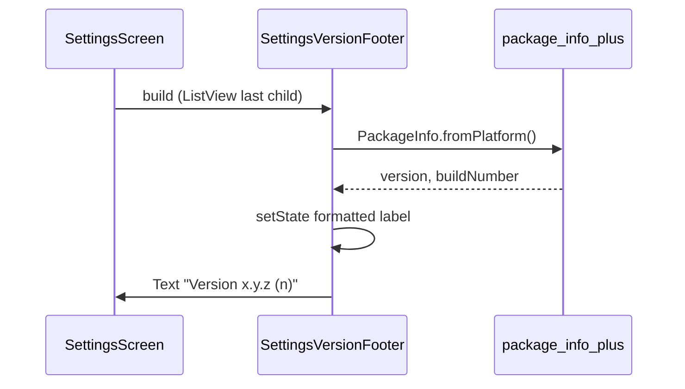

# Settings Version Footer — Design Spec

**Date:** 2026-05-30  
**Project:** `lecture_viewer_v3`  
**Status:** Approved in brainstorming  

## Goal

Show the installed app version at the bottom of the Settings screen so users and support can identify which build is running.

## Decisions (brainstorming)

| Topic | Decision |
|-------|----------|
| Format | `Version 1.2.7 (47)` — label + version name + build number in parentheses |
| Placement | Last child of Settings `ListView`; scrolls with content (not pinned) |
| Data source | `package_info_plus` — runtime read from platform (`PackageInfo.fromPlatform()`) |
| Architecture | **Approach A:** dedicated `SettingsVersionFooter` widget with local async load in `initState` |
| Loading state | Hidden (`SizedBox.shrink()`) — no placeholder flash |
| Error state | Hidden silently — no version line if load fails |
| Scope | Settings screen only; no tap-to-copy, no debug-only variants |

## Current state

- Settings UI: `lib/features/settings/presentation/settings_screen.dart` — `ListView` with Display, Device, and Advanced sections.
- App version in `pubspec.yaml`: `1.2.7+47` (maps to `PackageInfo.version` + `PackageInfo.buildNumber` on device).
- No `package_info_plus` dependency or version display widget exists today.

## UI

### Widget

**New file:** `lib/features/settings/presentation/settings_version_footer.dart`

- `StatefulWidget` (not Riverpod — version is read once, Settings-only).
- In `initState`, call `PackageInfo.fromPlatform()` and `setState` with formatted label.
- Format string: `'Version ${info.version} (${info.buildNumber})'`.

### Layout & styling

- Inserted as the last child of the Settings `ListView`, after the Advanced section.
- Top spacing: `SizedBox(height: 24)` above the text.
- Text: centered, `theme.textTheme.bodySmall`, color `theme.colorScheme.onSurfaceVariant`.
- Bottom padding inherited from existing `ListView` padding (`EdgeInsets.fromLTRB(16, 12, 16, 24)`).

### Wire-up

**Modify:** `lib/features/settings/presentation/settings_screen.dart`

Add `const SettingsVersionFooter()` after `CollapsibleSettingsSectionCard` (Advanced).

## Dependency

**Modify:** `pubspec.yaml`

```yaml
package_info_plus: ^8.3.0
```

Use current stable `^8.x` line compatible with SDK `^3.10.1`.

## Data flow



## Error handling

| Case | Behavior |
|------|----------|
| `PackageInfo.fromPlatform()` succeeds | Show formatted version text |
| Future still pending | Render nothing |
| Future throws | Render nothing (catch in `initState` async callback) |

## Out of scope

- App name prefix (e.g. "Lecture Viewer 1.2.7")
- Tap-to-copy version string
- Version on Home or other screens
- Debug-only build number hiding
- Riverpod `FutureProvider` (unnecessary for single static footer)
- Hardcoded version constant from `pubspec.yaml`

## Testing

Manual verification on iOS and Android:

1. Open Settings → scroll to bottom.
2. Confirm text matches installed build, e.g. `Version 1.2.7 (47)`.
3. Confirm text uses muted secondary styling and does not overlap section cards.

Automated widget test: **optional** — not required for this task.

## Files touched

| Action | Path |
|--------|------|
| Create | `lib/features/settings/presentation/settings_version_footer.dart` |
| Modify | `lib/features/settings/presentation/settings_screen.dart` |
| Modify | `pubspec.yaml` |
