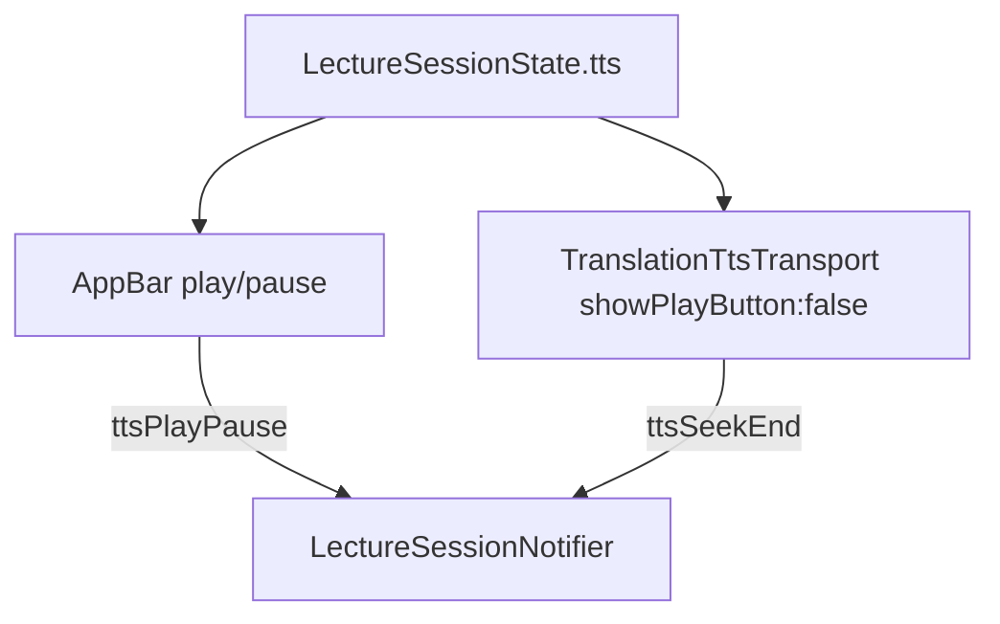

# Lecture Viewer — TTS Play Button in AppBar

**Date:** 2026-06-04  
**Project:** `lecture_viewer_v3`  
**Status:** Approved in brainstorming  
**Amends:** `docs/superpowers/specs/2026-05-18-lecture-viewer-tts-design.md` (collapsed play location)

## Goal

Move the TTS **play/pause button** from `LectureSessionControls` into the **AppBar**, placed immediately left of the expand/collapse toggle. The **seek slider and buffered duration** stay in the controls row exactly as today — same widget, same responsive breakpoints, same pending-download indicator — minus the play button (no duplication).

## Decisions

| Topic | Decision |
|-------|----------|
| Play/pause location | AppBar `actions`, left of toggle (`[▶/⏸] [⌄/⌃]`) |
| Slider + duration | Unchanged in `LectureSessionControls` when `!expanded` |
| Controls panel when collapsed | **Still visible** — shows slider row only (play removed from row) |
| Controls panel when expanded | Unchanged — language/module dropdowns + text scale; no slider |
| Unavailable voice | Grey play icon in AppBar; slider row hidden (same as today) |
| `lecture_common` | Add optional `showPlayButton` on `TranslationTtsTransport` (default `true`) |

## Layout

```
Collapsed (!expanded):
┌─────────────────────────────────────────┐
│ ←  sessionId              [▶/⏸] [⌄]   │  AppBar
├─────────────────────────────────────────┤
│ ───●──────────────  02:34              │  slider + duration (no play)
├─────────────────────────────────────────┤
│           Transcript body               │
└─────────────────────────────────────────┘

Expanded:
┌─────────────────────────────────────────┐
│ ←  sessionId              [▶/⏸] [⌃]   │  AppBar
├─────────────────────────────────────────┤
│ Language / Shortening / text scale      │  (no slider — same as today)
├─────────────────────────────────────────┤
│           Transcript body               │
└─────────────────────────────────────────┘
```

## Architecture

No change to TTS data flow (`LectureTtsController`, `TtsPaneSnapshot`, notifier methods). UI-only relocation.



## Component changes

### `lecture_session_screen.dart`

- Add `_LectureTtsAppBarButton` (private `ConsumerWidget`) to AppBar `actions`, before the toggle `IconButton`.
- Watch `lectureSessionProvider(scope)` for `tts`, `selectedLanguage`, `computedSenders`.
- Reuse play/blocked logic from `_LectureTtsControls` (voice unavailable, waiting for buffer, play/pause).
- Match toggle styling: `iconSize: 36`.

### `lecture_session_controls.dart`

- Remove play-only branch from collapsed row.
- When `!expanded` and voice available: render `TranslationTtsTransport(showPlayButton: false, ...)`.
- When `!expanded` and voice unavailable: hide slider row (AppBar shows grey play).
- Remove `_LectureTtsControls` or refactor so play logic lives only in AppBar widget (seek row stays here).

### `lecture_common` — `translation_tts_transport.dart`

- Add `showPlayButton` parameter, default `true`.
- When `false`, render slider + duration row only (same `LayoutBuilder` breakpoints: slider ≥96px, duration ≥152px).
- Existing callers (2-way app) unchanged.

## Play button behavior (AppBar)

Identical to current `_LectureTtsControls` play semantics:

| State | Icon | Tap |
|-------|------|-----|
| Voice unavailable | Grey `play_arrow` | SnackBar with `ttsVoiceUnavailableMessage` |
| Available, buffer empty | `play_arrow` | SnackBar "Waiting for audio…" |
| Available, buffer > 0, paused | `play_arrow` | `notifier.ttsPlayPause()` |
| Available, playing | `pause` | `notifier.ttsPlayPause()` |

## Edge cases

| Case | Behavior |
|------|----------|
| Playing + expand panel | Play/pause still on AppBar; slider hidden (expanded has no seek row — same as today) |
| Language change | TTS resets; AppBar icon updates; slider row resets |
| Collapse while playing | Slider row reappears; playback continues; AppBar shows pause |

## Out of scope

- Moving slider into AppBar or expanded panel
- Changing TTS engine, buffering, or language-switch logic
- 2-way app layout changes

## Testing

| Area | Check |
|------|-------|
| `lecture_common` | Widget test: `showPlayButton: false` hides play `IconButton`, slider still renders |
| Viewer manual | Collapsed: play on AppBar, seek on row; expand/collapse; unavailable voice; empty buffer tap |
