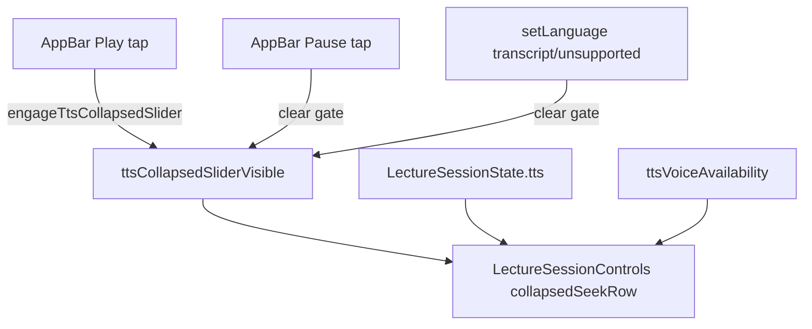

# Lecture Viewer — TTS Collapsed Slider Gate

**Date:** 2026-06-05  
**Project:** `lecture_viewer_v3`  
**Status:** Approved in brainstorming  
**Amends:** `docs/superpowers/specs/2026-06-04-lecture-viewer-tts-appbar-play-design.md` (collapsed slider visibility)

## Goal

Gate the collapsed seek slider so it appears only after the user engages TTS via the AppBar play button, while the selected language supports TTS. Hide the slider on pause and when switching to Transcript or an unsupported language.

## Decisions

| Topic | Decision |
|-------|----------|
| Show slider | `!expanded` + TTS-supported language + user tapped AppBar Play |
| Play tap with empty buffer | Still engages gate (slider shows at 0:00; snackbar unchanged) |
| Hide on pause | AppBar pause tap clears gate; collapsed controls row disappears |
| Hide on language change | Only Transcript or `languageUnsupported` clears gate |
| TTS → TTS language change | Gate preserved (user does not need to tap Play again) |
| Implementation | `ttsCollapsedSliderVisible` flag in `LectureSessionState` |
| `lecture_common` | No changes |

## Layout

```
Before first Play tap (collapsed, TTS language selected):
┌─────────────────────────────────────────┐
│ ←  sessionId              [▶] [⌄]       │  AppBar
├─────────────────────────────────────────┤
│           Transcript body               │  (no controls row)
└─────────────────────────────────────────┘

After Play tap (collapsed, playing or waiting for buffer):
┌─────────────────────────────────────────┐
│ ←  sessionId              [▶/⏸] [⌄]     │  AppBar
├─────────────────────────────────────────┤
│ ───●──────────────  02:34              │  slider + duration
├─────────────────────────────────────────┤
│           Transcript body               │
└─────────────────────────────────────────┘

After Pause (collapsed):
┌─────────────────────────────────────────┐
│ ←  sessionId              [▶] [⌄]       │  AppBar
├─────────────────────────────────────────┤
│           Transcript body               │  (controls row hidden again)
└─────────────────────────────────────────┘
```

## Architecture

UI-only gate layered on existing TTS flow. No engine or `TtsPaneSnapshot` changes.



## State

### `LectureSessionState`

Add field:

```dart
final bool ttsCollapsedSliderVisible; // default false
```

Update `copyWith` with `bool? ttsCollapsedSliderVisible`.

## Notifier hooks

### `engageTtsCollapsedSlider()`

- Sets `ttsCollapsedSliderVisible = true`.
- Called from `LectureTtsAppBarButton` on every Play tap, before buffer/can-play checks.

### `ttsPlayPause()`

- When `state.tts.isPlaying == true` (user is pausing): set `ttsCollapsedSliderVisible = false`, then call engine pause as today.
- When not playing (user is starting play): gate already set by `engageTtsCollapsedSlider()`; proceed with engine play as today.

### `setLanguage()` / `_applyLanguageChange()`

After resolving new language, if `ttsVoiceAvailability` is `transcriptMode` or `languageUnsupported`, set `ttsCollapsedSliderVisible = false`.
Do not clear gate when switching between two TTS-supported languages.

## UI changes

### `lecture_tts_app_bar_button.dart`

On Play `IconButton` `onPressed`:

1. Call `notifier.engageTtsCollapsedSlider()`.
2. Call existing `onLectureTtsPlayPressed(...)` logic.

Unavailable-voice `volume_off` button unchanged (does not engage gate).

### `lecture_session_controls.dart`

Replace collapsed row condition:

```dart
final collapsedSeekRow = !expanded
    && voiceAvailability == TtsVoiceAvailability.available
    && ttsCollapsedSliderVisible;
```

Watch `ttsCollapsedSliderVisible` via `lectureSessionProvider(scope).select`.

## Edge cases

| Case | Behavior |
|------|----------|
| Tap Play, buffer empty | Gate on; slider shows 0:00; snackbar "Waiting for audio…" |
| Tap Play, buffer ready | Gate on; playback starts; slider shows position |
| Tap Pause | Gate off; collapsed row hidden (`SizedBox.shrink`) |
| Tap Play again after pause | Gate on again; slider reappears |
| Expand while playing | Slider hidden (expanded panel has no seek row — unchanged) |
| Collapse while playing | Slider visible if gate still true |
| Transcript / unsupported language | Gate off; slider hidden |
| TTS → TTS language change while playing | Gate stays true; existing language-change TTS reset applies |
| Remote play/pause (media session) | Does not engage or clear gate (AppBar-only semantics) |

## Out of scope

- Changing TTS engine, buffering, or seek behavior
- Moving slider to AppBar or expanded panel
- Gate on remote/media-session play
- `lecture_common` changes

## Testing

| Area | Check |
|------|-------|
| `lecture_session_notifier` unit tests | `engageTtsCollapsedSlider` sets visible; pause clears; transcript/unsupported language clears; TTS→TTS preserves gate |
| Manual | Collapsed: no slider until Play; pause hides; Play again shows; language dropdown to Transcript hides |
