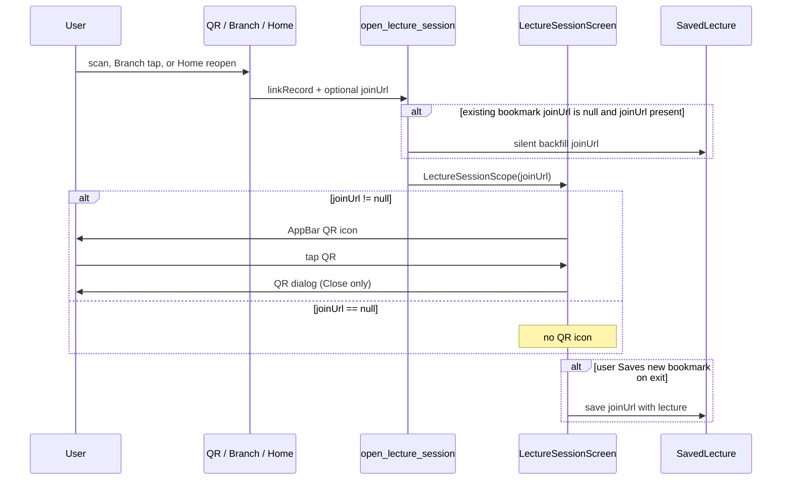

# Live Session Join QR — Design Spec

**Date:** 2026-10-15  
**Project:** `lecture_viewer_v3`  
**Status:** Approved in brainstorming

## Goal

Let a viewer share a live session they already joined. After QR scan or Branch open, keep the original join URL, show a QR icon on the live session AppBar when that URL exists, and display a QR-only dialog so someone else can scan and join the same session.

## Decisions (brainstorming)

| Topic | Decision |
|-------|----------|
| App | `lecture_viewer_v3` only (not `2way-v2` host QR) |
| Persist URL | In the live session immediately, and on the bookmark if the user saves (or already saved) |
| Dialog actions | **Close** only — no copy link, no Share QR image |
| Missing URL | Hide the QR button — never reconstruct `https://lectureviewer.app.link/…?link_record=…` |
| Branch | Treat as a join URL: persist the incoming lecture app link when valid |
| Architecture | Approach 1: optional `joinUrl` on `LectureSessionScope` and `SavedLecture` |

## Problem today

QR and Branch extract `linkRecord` only. The live session AppBar has no way to show the join QR. Saved lectures store `linkRecord` / `sessionId` but not the original `lectureviewer.app.link` URL, so a later reopen cannot show the same QR.

## Target flow



---

## Data model

`joinUrl` is the original join URL after trim. It must pass `isLectureViewerAppLink`. Do not build it from `linkRecord`.

### `LectureSessionScope`

```dart
typedef LectureSessionScope = ({
  String sessionId,
  String linkRecord,
  String? joinUrl,
});
```

`lectureSessionScope(...)` takes optional `joinUrl` (default `null`).

### `SavedLecture`

Add optional `String? joinUrl`.

| JSON | Behavior |
|------|----------|
| Key missing or empty / whitespace | `null` |
| Non-empty string | stored trimmed value |

`copyWith` must accept `joinUrl` so backfill can set it. Existing prefs rows keep working without migration.

---

## Capture `joinUrl`

Pass `joinUrl` through `openLectureSessionFromLinkRecord` as an optional named argument. `openLectureSessionFromAppLink` passes the validated app-link string.

| Entry | `joinUrl` |
|-------|-----------|
| QR scan | Trimmed barcode `raw` when `isLectureViewerAppLink` is true |
| Branch | First value among `$canonical_url`, `+url`, `$desktop_url`, `~referring_link` that parses as a lecture app link; else `null` |
| Home reopen | `lecture.joinUrl` (may be `null` on old bookmarks) |
| Debug / other | `null` unless the caller already has a valid lecture app link |

Session still opens when `linkRecord` is valid and `joinUrl` is `null`. QR icon stays hidden.

Add `joinUrlFromBranchSession` next to the existing Branch helpers in `lib/core/util/lecture_app_link.dart`.

---

## Persist

**New bookmark (exit Save):** `handleLectureSessionExit` takes `joinUrl` from the session scope and writes it onto the new `SavedLecture`. Don't save discards it.

**Silent backfill (join time):** When opening a session with non-null `joinUrl`, if a bookmark for that `linkRecord` exists and its `joinUrl` is `null`, write `joinUrl` onto that row immediately. If the bookmark already has `joinUrl`, leave it (first-wins). Do not prompt.

Add `setJoinUrlIfMissing(linkRecord, joinUrl)` on `SavedLecturesNotifier` / repository. Home reopen continues to call `recordLastJoin` after a successful join; backfill is independent and runs from `openLectureSessionFromLinkRecord` before push.

---

## UI

**AppBar** on `LectureSessionScreen`: `IconButton` with `Icons.qr_code_2`, tooltip `Show join QR`, **left of** the TTS button. Render only when `scope.joinUrl != null`.

**Dialog** (`showLectureSessionQrDialog`): `AlertDialog`, barrier dismissible (tap outside and system back close it).

- Title: `Join to view transcription by QR`
- Body: `QrImageView` of `joinUrl`, white background, size 220
- Actions: `Close` only
- No copy-link row, no “or” divider, no Share QR

New file: `lib/features/lecture_session/presentation/lecture_session_qr_dialog.dart`.  
Dependency: `qr_flutter` in `lecture_viewer_v3`.

No QR control on Home, snapshot, or offline screens.

---

## Error handling

| Case | Behavior |
|------|----------|
| QR/Branch has `linkRecord` but no valid lecture app link | Open session, `joinUrl = null`, no icon |
| Old bookmark / Don't save | No persisted `joinUrl`; later reopen has no icon unless they join again with a URL and backfill applies |
| QR widget fails to build | Session stays open; Close / dismiss still works |
| Invalid QR / Branch link | Existing snackbars unchanged |

---

## Testing

| Case | Where |
|------|-------|
| `fromJson` without `joinUrl` → `null`; round-trip when present | `saved_lecture_test.dart` |
| `setJoinUrlIfMissing` sets null → value; does not overwrite | repository / provider tests |
| `joinUrlFromBranchSession` accepts valid lecture app link, returns `null` otherwise | `lecture_app_link_test.dart` |
| AppBar shows QR icon iff `joinUrl != null` | session screen (or dialog host) widget test |
| Dialog has title + Close; no copy / share / link text | `lecture_session_qr_dialog` widget test |
| QR / Branch / Home pass `joinUrl` into scope | `open_lecture_session_test.dart` and entry-path tests as needed |
| New save writes `joinUrl` | `save_lecture_on_exit` / provider tests |

---

## Files

| File | Change |
|------|--------|
| `lib/features/lecture_session/presentation/lecture_session_scope.dart` | Add `joinUrl` |
| `lib/core/saved_lectures/saved_lecture.dart` | Optional `joinUrl` + `copyWith` |
| `lib/core/saved_lectures/saved_lectures_repository.dart` | `setJoinUrlIfMissing` |
| `lib/core/saved_lectures/saved_lectures_provider.dart` | `add(joinUrl)` + `setJoinUrlIfMissing` |
| `lib/core/util/lecture_app_link.dart` | `joinUrlFromBranchSession` |
| `lib/core/util/open_lecture_session.dart` | Accept / pass `joinUrl`; backfill before push |
| `lib/features/home/presentation/qr_scan_screen.dart` | Pass scanned URL |
| `lib/app/branch_session_listener.dart` | Pass Branch URL |
| `lib/features/home/presentation/saved_lectures_list.dart` | Pass `lecture.joinUrl` |
| `lib/features/lecture_session/presentation/save_lecture_on_exit.dart` | Persist `joinUrl` on new save |
| `lib/features/lecture_session/presentation/lecture_session_screen.dart` | Conditional QR AppBar action |
| `lib/features/lecture_session/presentation/lecture_session_qr_dialog.dart` | New dialog |
| `pubspec.yaml` | `qr_flutter` |

---

## Out of scope

- `2way-v2` / host-app QR generation
- Reconstructing a join URL from `linkRecord` or the example Branch base path
- Copy link, Share QR image, Home list QR, snapshot / offline QR
- Changing shorten check, join availability, or bookmark prompt copy
